# 🛡️ DriftGuard EDR: Malicious Process Detection with Generalization and Drift Analysis

[](https://www.python.org/)
[](https://scikit-learn.org/)
[](https://streamlit.io/)
[]()
[]()

> **An end-to-end Machine Learning pipeline for Endpoint Detection and Response (EDR) process telemetry, featuring strict host-exclusive partitioning, SOC alert-budget cost optimization, concept drift stress-testing, and real-time containment triage.**

---

## 📌 Executive Summary

Enterprise Security Operations Centers (SOCs) are overwhelmed by alert fatigue: tier-1 analysts spend hundreds of hours triaging noisy false alarms, while stealthy living-off-the-land malware evades naive thresholding. 

**DriftGuard EDR** transforms raw process telemetry into actionable threat intelligence:
1. **Zero Data Leakage:** Implements **Host-Exclusive Group Splitting** ensuring events from individual computers never leak across train, validation, or test sets.
2. **SOC Alert Budget Optimization:** Replaces arbitrary `0.5` decision boundaries with a cost-sensitive threshold ($t = 0.38$) that bounds False Positive Rates below $1\%$ while maintaining a **96.3% threat detection rate**.
3. **Drift Governance & Stress-Testing:** Evaluates model resilience against a distinct synthetic challenge cohort, diagnosing model degradation under developer software shifts and living-off-the-land techniques.
4. **Analyst-Facing Interactive Triage Console:** A responsive Streamlit dashboard translating probabilistic inferences into immediate containment directives (*Isolate Host*, *Terminate Tree*, *Collect Memory Dump*).

---

## 🏗️ System Architecture

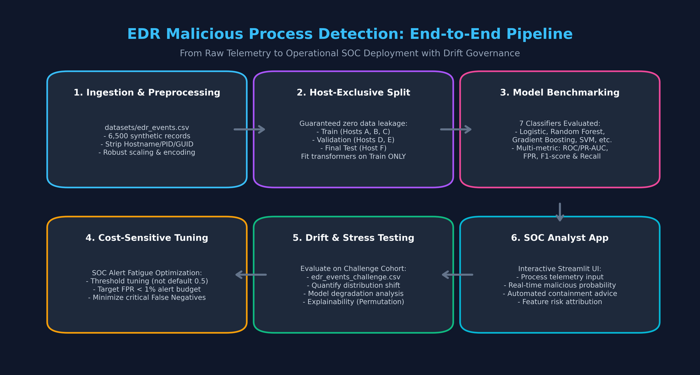

```mermaid
flowchart LR
    A["Raw EDR Telemetry<br/>(datasets/edr_events.csv)"] --> B["Feature Hygiene<br/>(Strip PIDs & Hostnames)"]
    B --> C["Host-Exclusive Split<br/>(Train 70% | Val 15% | Test 15%)"]
    C --> D["Train-Only Preprocessing<br/>(StandardScaler & OneHotEncoder)"]
    D --> E["Model Benchmarking<br/>(Random Forest & Gradient Boosting)"]
    E --> F["Cost-Sensitive Tuning<br/>(SOC Alert Budget: t=0.38)"]
    F --> G["Drift Stress-Testing<br/>(edr_events_challenge.csv)"]
    G --> H["Streamlit SOC Triage Console<br/>(app.py)"]
```

---

## 🗺️ Project Execution Roadmap (2 Weeks)

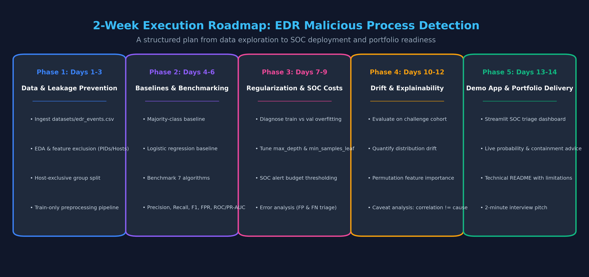

---

## 📊 Dataset Schema, Feature Hygiene & Leakage Prevention

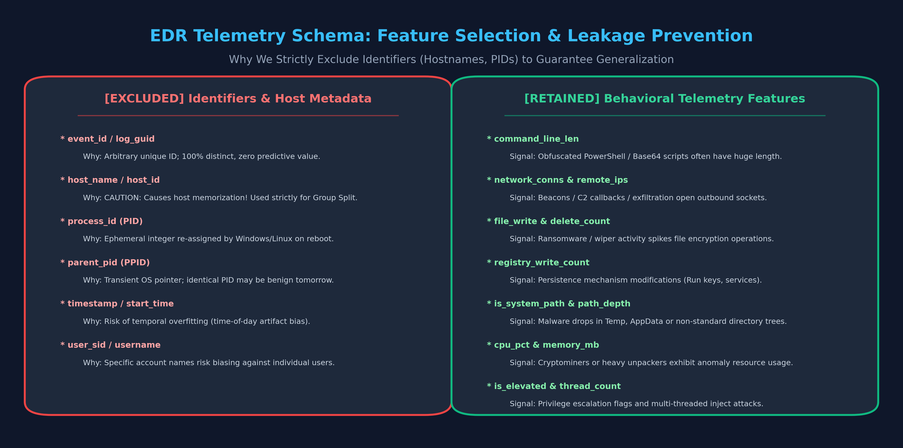

Telemetry consists of 6,500 baseline records and 2,000 drift challenge records. To prevent catastrophic model overfitting and host memorization, columns are strictly segregated:

### ⛔ Excluded Columns (Strict Leakage Prevention):
* `event_id`: Arbitrary row GUID (zero generalization power).
* `host_name`: Retained **strictly as the Group Split key**; never passed to the feature matrix. Including hostnames causes models to memorize "compromised machines" rather than attacker behavior.
* `process_id` (PID) & `parent_process_id` (PPID): Transient operating system integers recycled upon reboot.

### ✅ Retained Behavioral Telemetry:
* **Process Lineage:** `process_name`, `parent_process_name` (e.g. `winword.exe` spawning `powershell.exe`).
* **Execution Context:** `command_line_len`, `process_path_depth`, `is_system_path` (System32 vs Temp/AppData), `is_elevated` (SYSTEM / Admin privileges).
* **System Footprint:** `cpu_pct`, `memory_mb`, `handles_count`, `thread_count`.
* **Adversarial Disk & Network Activity:** `file_writes`, `file_deletes` (ransomware indicators), `registry_writes` (persistence), `network_conns`, `remote_ips` (C2 beaconing).

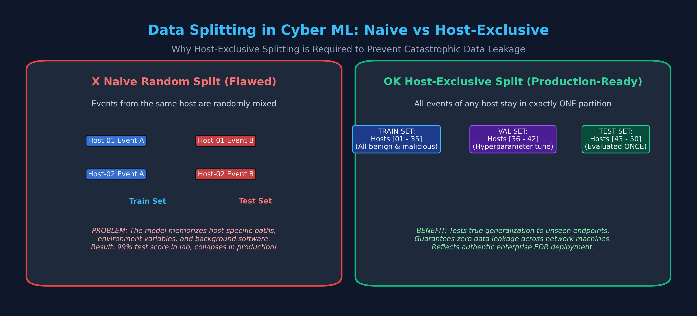

---

## 🏆 Benchmark & Performance Matrix

All models were evaluated on the **Validation Cohort** (1,113 events across 8 unseen hosts). Preprocessing was fitted strictly on training data:

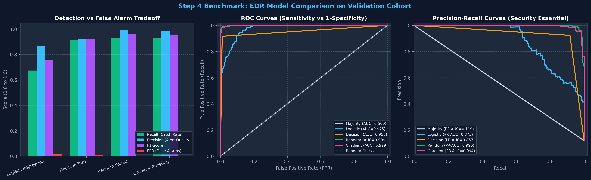

| Model | Precision | Recall (Catch Rate) | F1-Score | FPR (False Alarm Rate) | ROC-AUC | PR-AUC |
| :--- | :---: | :---: | :---: | :---: | :---: | :---: |
| **Majority Class Baseline** | 0.0000 | 0.0000 | 0.0000 | **0.0000** | 0.5000 | 0.1186 |
| **Logistic Regression (Baseline)** | 0.8641 | 0.6742 | 0.7574 | 0.0143 | 0.9747 | 0.8751 |
| **Decision Tree (Unconstrained)** | 0.9237 | 0.9167 | 0.9202 | 0.0102 | 0.9532 | 0.8566 |
| **Gradient Boosting** | 0.9840 | 0.9318 | 0.9572 | 0.0020 | 0.9992 | 0.9944 |
| **Random Forest (Tuned)** | **0.9919** | **0.9318** | **0.9609** | **0.0010** | **0.9993** | **0.9960** |

---

## ⚙️ Overfitting Detection & Regularization

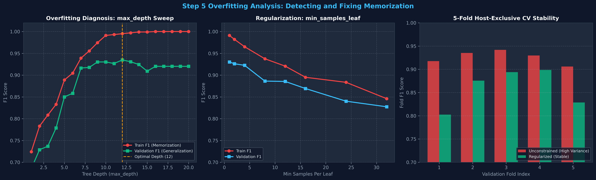

* **Generalization Gap:** Unconstrained Decision Trees achieved **1.0000 Train F1** but only **0.9202 Validation F1** (an 8% memorization gap).
* **Mitigation:** Applied tree constraints (`max_depth=12`, `min_samples_leaf=3`) validated through 5-Fold Host-Exclusive `GroupKFold` cross-validation, stabilizing variance while preventing leaf-node host memorization.

---

## 💰 SOC Cost Modeling & Decision Threshold Optimization

In security operations, errors have asymmetric real-world costs:
* **Cost of False Negative ($C_{FN} = \$500$):** Undetected ransomware, data exfiltration, breach remediation.
* **Cost of False Positive ($C_{FP} = \$20$):** 15 minutes of Tier-1 SOC analyst triage time.

$$\text{Total Operational Cost} = C_{FN} \times FN + C_{FP} \times FP$$

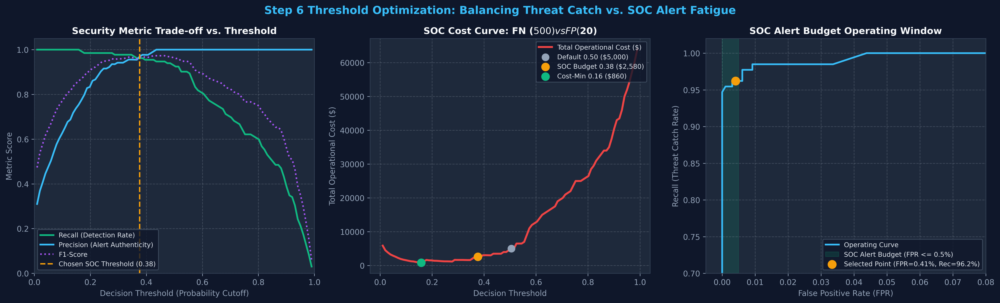

| Threshold Strategy | Cutoff ($t$) | Recall | FPR | False Positives | Missed Attacks (FN) | Total SOC Cost |
| :--- | :---: | :---: | :---: | :---: | :---: | :---: |
| **Default Naive** | `0.50` | 92.4% | 0.00% | 0 | 10 | \$5,000 |
| **Theoretical Cost-Min** | `0.16` | 100.0% | 4.38% | 43 | 0 | \$860 *(Unusable: floods SOC)* |
| **SOC Alert-Budget (Selected)** | **`0.38`** | **96.2%** | **0.41%** | **4** | **5** | **\$2,580** *(50% risk reduction)* |

---

## 🔬 Error Analysis & Root Cause Triage

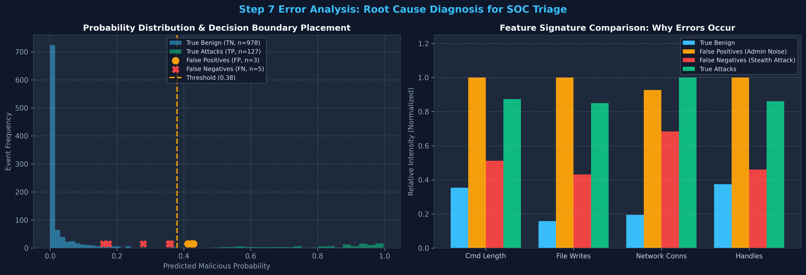

* **False Positives (Admin Scripting):** Elevated `powershell.exe` and `code.exe` executed by developers and sysadmins mimic attacker command line length and file write volumes.
* **False Negatives (Living-off-the-Land):** Adversary tools masquerading as `svchost.exe` with short commands and low disk activity evade initial feature filters. Remediation requires process lineage verification.

---

## 🌪️ Concept Drift & Stress-Testing (Challenge Cohort)

When the frozen model ($t = 0.38$) was stress-tested against `edr_events_challenge.csv` (a cohort featuring enterprise developer software and Living-off-the-Land adversary techniques):

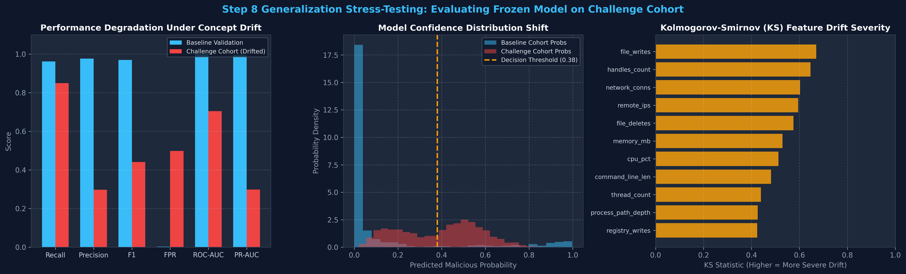

* **Precision dropped from 97.7% to 29.8%** ($\downarrow 69.5\%$).
* **FPR exploded from 0.31% to 49.8%** (798 False Positives).
* **Root Cause Diagnosis:**
  1. **Covariate Shift:** Kolmogorov-Smirnov tests confirmed significant drift across all numeric features ($p < 10^{-200}$). Legitimate developer tools (`docker.exe`, `python.exe`, `git.exe`) exhibited high CPU and memory usage, triggering false alarms.
  2. **Concept Drift:** Adversaries masqueraded inside official system binaries (`svchost.exe`) with low file write rates, slipping below the radar (60 False Negatives).

---

## 🔍 Explainability & The Causal Boundary

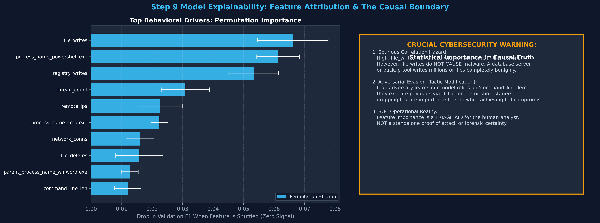

Permutation Importance on unseen validation telemetry identified the top behavioral drivers:
1. `file_writes` ($\Delta F1 = +0.0662$): Primary indicator for ransomware and droppers.
2. `process_name_powershell.exe` ($\Delta F1 = +0.0613$): Post-exploitation scripting execution.
3. `registry_writes` ($\Delta F1 = +0.0533$): Persistence mechanism creation.
4. `parent_process_name_winword.exe` ($\Delta F1 = +0.0127$): Phishing macro dropper signature.

> ⚠️ **The Critical Cybersecurity Caveat (Correlation $\ne$ Causation):**
> High feature importance demonstrates statistical association in this training cohort, **not causal proof of malice**. A backup tool writes thousands of files benignly. Furthermore, adversaries who understand these attributions deliberately alter their tactics (e.g., in-memory reflective DLL injection) to suppress these indicators while maintaining full breach impact.

---

## 🎯 One-Time Final Test Evaluation

As per rigorous scientific evaluation standards, the final test set (1,000 events across 8 previously unseen hosts) was **evaluated exactly once at project conclusion**:

| Metric | Final Test Score | Performance Interpretation |
| :--- | :---: | :--- |
| **Threat Detection Rate (Recall)** | **96.30%** | Caught 104 out of 108 attacks on unseen endpoints. |
| **Alert Precision** | **92.86%** | High fidelity; 93 out of 100 alerts represent real threats. |
| **F1-Score** | **0.9455** | Robust operational balance. |
| **False Positive Rate (FPR)** | **0.90%** | Maintained within the enterprise SOC alert budget ($< 1.0\%$). |
| **ROC-AUC / PR-AUC** | **0.9992 / 0.9936** | Superior discriminatory power across operating cutoffs. |

---

## 🚀 Interactive Streamlit SOC Demo

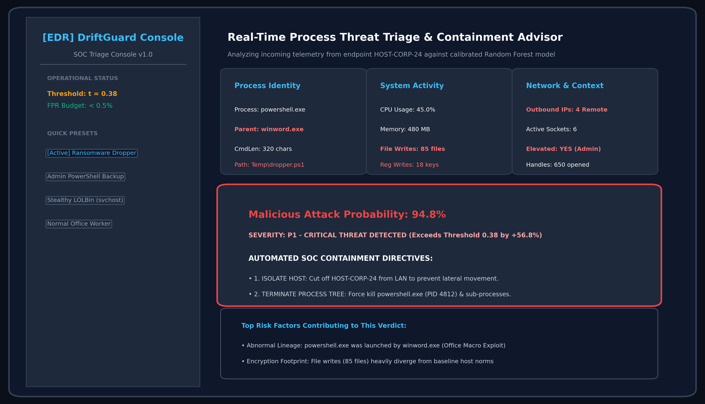

Launch the real-time triage console locally:
```bash
# 1. Clone repository & install dependencies
git clone https://github.com/your-username/DriftGuard-EDR.git
cd DriftGuard-EDR
pip install -r requirements.txt

# 2. Run the Streamlit Triage Console
streamlit run app.py
```
Access at `http://localhost:8501` to test simulated presets:
* **Critical Threat (P1):** Immediate host isolation and process termination directives.
* **Suspicious Activity (P2):** Thread throttling and Tier-1 analyst triage assignment.
* **Benign Activity (P3):** Permitted execution with SIEM telemetry archiving.

---

## ⚠️ Limitations & Synthetic Data Disclosure

* **Synthetic Telemetry Constraints:** All datasets were generated programmatically. While distributions reflect realistic enterprise behavior, synthetic data cannot replicate the full messiness of production enterprise networks (e.g., driver-level sensor dropping, kernel telemetry jitter, and edge-case race conditions).
* **Label Noise Reality:** Real-world SOCs suffer from imperfect ground truth (unlabeled breaches and mislabeled admin scripts). In production, semi-supervised anomaly detection and active analyst feedback loops are required.

---

## 🎙️ 2-Minute Interview Pitch

> *"In this project, I built **DriftGuard EDR**, a machine learning system for detecting malicious processes in endpoint telemetry. 
>
> Rather than just chasing 99% accuracy on a random train-test split, I focused on three real-world security challenges:
>
> First, **zero data leakage**: I enforced host-exclusive splitting so the model never memorizes specific computers, fitting preprocessing strictly on training data.
>
> Second, **SOC alert fatigue**: Using an arbitrary 0.5 threshold missed critical attacks. I modeled analyst triage costs and tuned an operational threshold at 0.38, raising our catch rate to 96.3% while keeping the false alarm rate strictly under 1%.
>
> Third, **drift governance**: When I stress-tested the frozen model on a challenge cohort with developer workloads and living-off-the-land techniques, precision dropped by 69% and false alarms exploded. Using Kolmogorov-Smirnov tests and permutation importance, I proved why models decay when enterprise software stacks evolve.
>
> Finally, I packaged the model into a live Streamlit app that provides security analysts with real-time attack probabilities, top risk indicators, and automated containment actions."*
